# TabSync Studio

<div align="center">

[](LICENSE)
[]()
[](https://nodejs.org/)
[](https://swift.org/)
[](https://developer.android.com/)

**Turn any Android tablet into an ultra-low-latency graphics tablet, live screen annotation pen display, and remote precision controller for macOS.**

[Features](#features) • [Architecture](#architecture) • [Quick Start](#quick-start) • [Security & Privacy](#security--privacy) • [Build Guide](#build-guide) • [Contributing](#contributing)

</div>

---

## Overview

**TabSync Studio** connects an Android tablet directly to macOS over local Wi-Fi, transforming it into a high-precision, pressure-sensitive pen display (Wacom/Cintiq alternative), transparent desktop screen annotator, and multi-touch remote trackpad.

```mermaid
flowchart LR
    subgraph Tablet["Android Tablet (Client)"]
        Pen["S-Pen / Stylus (PointerEvents)"]
        Gestures["Multi-Touch Gestures (2-Finger Undo / 3-Finger Redo)"]
        AI["AI Smart Shape Recognizer"]
        WV["Android WebView (Cert Pinning)"]
        
        Pen --> AI
        AI --> WV
        Gestures --> WV
    end

    subgraph Transport["Network Layer (Encrypted Local Transport)"]
        TLS["Mutual TLS / WSS (:4444)"]
        PIN["Cryptographic PIN / Token Handshake"]
        ANTI_REPLAY["Anti-Replay Timestamp Windows"]
    end

    subgraph Mac["macOS Host Machine"]
        SRV["Node.js Server (Express + WSS)"]
        IPC["Native WKScriptMessageHandler"]
        APP["TabSync Studio (Swift + AppKit)"]
        OVERLAY["Transparent Annotation Overlay"]
        INPUT["mac-input (CoreGraphics CGEvent Tap)"]

        SRV --- IPC
        IPC --- APP
        APP --- OVERLAY
        SRV --- INPUT
    end

    WV <==> Transport
    Transport <==> SRV
```



---

## Features

* **Pressure-Sensitive S-Pen / Active Stylus**: Continuous pressure curve sampling via W3C Pointer Events API with hardware palm rejection.
* **✨ AI Smart Shape & Curve Recognition**: Real-time statistical classification snaps rough hand-drawn strokes into perfect geometric shapes (lines, circles, rectangles, arrows) while preserving cursive handwriting.
* **Multi-Touch Gestures**: Two-finger tap to **Undo**, three-finger tap to **Redo**, and automatic cancellation of accidental hand contact.
* **Desktop Annotation Overlay**: An invisible, transparent macOS window that projects live stylus markings directly on top of open desktop windows, IDEs, and browser tabs.
* **Remote Precision Trackpad**: Relative cursor glide, tap-to-click, two-finger wheel scrolling, and virtual drag lock.
* **Laser Pointer Mode**: High-visibility glowing laser with realistic fading trail for presentations and video calls.
* **Zero Cloud Dependency**: Operates entirely within your local area network (LAN) with mutual TLS encryption.

---

## Architecture

| Component | Technology | Role |
| :--- | :--- | :--- |
| **macOS Host App** | Swift 5, AppKit, WebKit, CoreGraphics | System menu bar item, floating widget, transparent annotation overlay. |
| **Input Driver** | Swift (`mac-input`), CoreGraphics C APIs | Sub-millisecond `CGEvent` synthesis and direct Unicode typing without modifying the macOS pasteboard. |
| **Coordination Server** | Node.js (v20+), Express 5, `ws` (WSS) | Dynamic self-signed TLS generation, message schema validation, rate-limiting, and input arbitration. |
| **Android Client** | Java 8/21, Android WebView, Gradle | Hardened WebView container with SHA-256 certificate fingerprint pinning. |
| **Vector Canvas** | HTML5 Canvas 2D, ES2022 JavaScript | Sub-pixel Bézier spline interpolation and vector coordinate normalization. |

---

## Quick Start

### Prerequisites
* **macOS**: macOS 12 Monterey or newer (Apple Silicon & Intel supported).
* **Node.js**: v20.0.0 or higher.
* **Android Tablet**: Android 7.0 (API 24) or higher with Chrome or Samsung Internet.

### 1. Clone & Install
```bash
git clone https://github.com/your-username/tabsync-studio.git
cd tabsync-studio
npm install
```

### 2. Start the Host Server
```bash
./start.sh
```
*(or run `npm start`)*

The Mac Host dashboard will open at `https://localhost:4444`.

### 3. Connect Tablet
Scan the QR code displayed on the Mac dashboard with your Android tablet camera or navigate to the displayed pairing URL.

---

## Security & Privacy

* **Dynamic Self-Signed TLS with SANs**: Automatically provisions an in-memory or persistent RSA-2048 certificate with dynamic Subject Alternative Names covering all active LAN interfaces (`security/tls.js`).
* **Android SHA-256 Certificate Pinning**: Enforces `cleartextTrafficPermitted="false"` and cryptographically validates the host's DER certificate fingerprint, defeating LAN Man-in-the-Middle (MitM) attacks.
* **Zero-DOM Host Secret IPC**: Administrative secrets are never injected into `window` or DOM scope. Communication uses native `WKScriptMessageHandler` handlers (`postMessage({ action: 'hostApi', ... })`).
* **URL Hash Fragment Credentials**: Pairing tokens are passed strictly in URL hash fragments (`#token=...&pin=...`), never transmitted in HTTP request lines or logged in web server logs, and immediately scrubbed from browser history.
* **Anti-Replay Protection**: Privileged WebSocket commands enforce monotonic timestamp freshness windows.

---

## Build Guide

### Automated Tests
Run the complete unit and network integration test suite:
```bash
npm test
```

### Build Native macOS Input Helper
```bash
npm run build:mac-input
```

### Build TabSync Studio macOS Application
```bash
npm run build:mac-app
```

### Build Android APK / App Bundle
```bash
# Debug build
cd android && ./gradlew assembleDebug

# Release build (configure keystore.properties first)
cp android/keystore.properties.example android/keystore.properties
./gradlew assembleRelease bundleRelease
```

---

## Contributing

Pull requests are welcome! Please ensure that all automated unit and integration tests pass before submitting:
```bash
npm test
```

---

## License

This project is licensed under the [MIT License](LICENSE).
